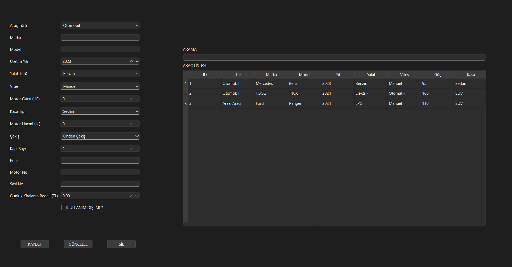
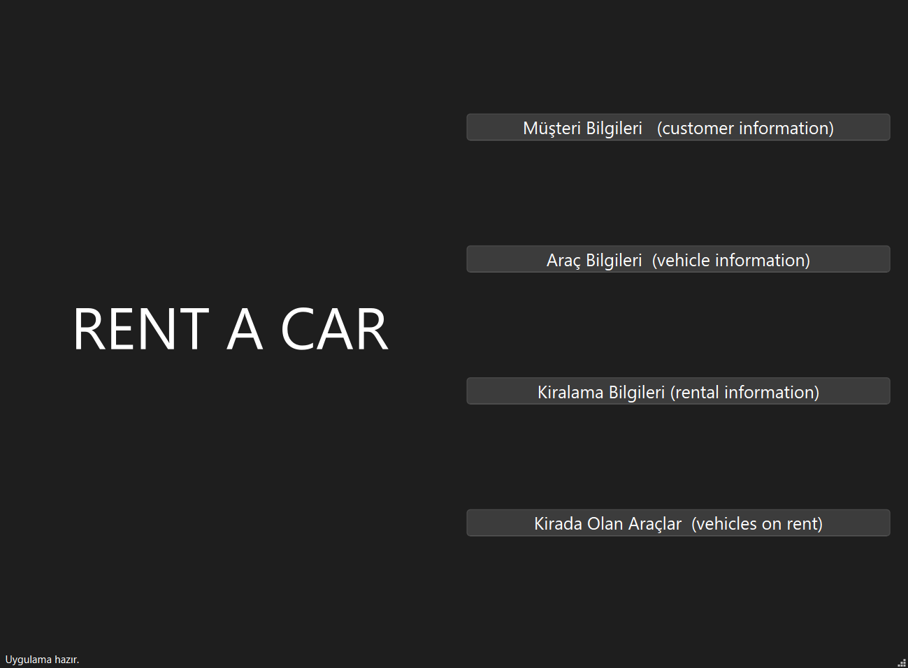
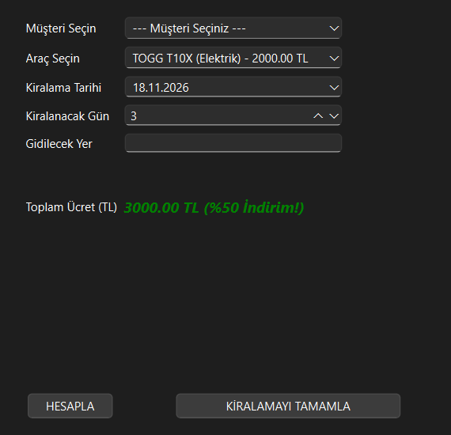

# Rent a Car Automation

A desktop car rental management application built with Python, PySide6 (Qt) and MySQL. It manages vehicles, customers and rentals, and includes features for electric vehicles. The user interface is in Turkish.



## Features
- **Vehicle management:** add, update and search vehicles with detailed specs (brand, model, fuel type, gearbox, engine power, body type, daily price) and mark vehicles as out of service
- **Customer management:** customer records with contact and driver's license information
- **Rentals:** create a rental, calculate the total price for the selected number of days and list vehicles that are currently rented
- **Electric vehicle support:** range (km) tracking for electric vehicles and an automatic 50% discount on their rentals
- **Self-setting database:** on first run the app creates the database and tables, adds missing columns to older databases and inserts sample vehicles

## Screenshots
| Main menu | Rental with the electric vehicle discount |
|---|---|
|  |  |

## Tech stack
Python · PySide6 (Qt for Python, Qt Designer `.ui` files) · MySQL (`mysql-connector-python`)

## Getting started
1. Install Python 3 and a MySQL server (for example with Laragon or XAMPP).
2. Install the dependencies:
   ```bash
   pip install -r requirements.txt
   ```
3. Set your MySQL password as an environment variable (PowerShell):
   ```powershell
   $env:RENTACAR_DB_PASSWORD = "your-mysql-password"
   ```
   Optional: `RENTACAR_DB_HOST` (default `localhost`), `RENTACAR_DB_PORT` (default `3306`) and `RENTACAR_DB_USER` (default `root`).
4. Run the app:
   ```bash
   python MainWindow.py
   ```

## Project structure
| File | Purpose |
|---|---|
| `MainWindow.py` | Entry point and main menu |
| `vehicle_widget.py`, `customer_widget.py`, `rental_widget.py`, `rental_list_widget.py` | Screens for vehicles, customers, rentals and the rental list |
| `database.py` | Connection, database and table creation, schema repair, sample data |
| `*.ui` / `ui_*.py` | Qt Designer layouts and the Python code generated from them |

## What I learned
- Designing a desktop UI in Qt Designer and connecting it to Python code
- Modeling vehicles, customers and rentals in a relational database
- Keeping an existing database compatible when new columns are added
- Putting business rules (electric vehicle discount) in one place in the code
